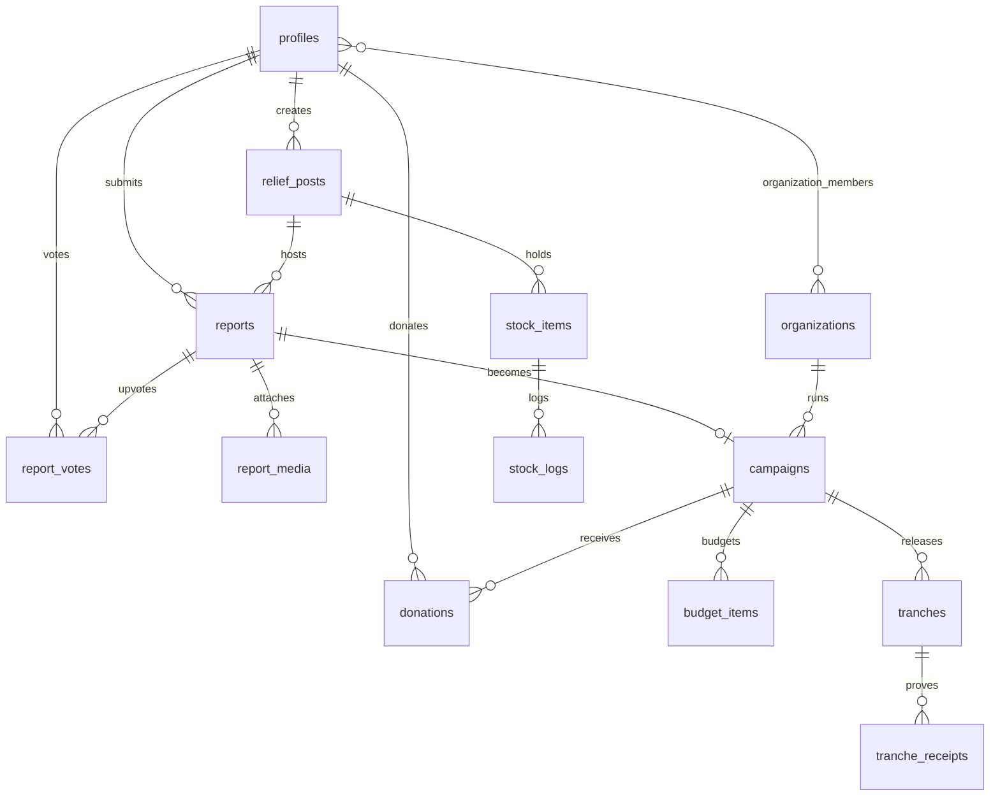

# PRD & Database Schema — Jangkau

> Dokumen kerja internal. Bahasa: Indonesia; identifier/kode: Inggris.
> Turunan dari proposal semifinal STACK 2026 ("Jangkau: AI-Based Platform for Fundraising, Distribution, and Relief Stock Monitoring in Disaster-Affected Areas", Case 2).
> Status: **v1.1 — keputusan §2 sudah di-ACC (bun workspaces + SSR)**. Semua keputusan di §2 bersifat mengikat untuk implementasi; kalau berubah, ubah dokumen ini dulu.

---

## 1. Ringkasan Produk

Jangkau menghubungkan **pelapor** (warga/koordinator pos), **organisasi kemanusiaan terverifikasi**, dan **donor** dalam satu alur yang bisa diaudit per pos pengungsian.

Alur inti (harus jalan end-to-end di Final Day):

```
Lapor (offline-first) → Klasifikasi & merge AI → Validasi geofence + upvote
→ Organisasi ambil alih → RAB → Konfirmasi pelapor → Donasi (Midtrans)
→ Pencairan bertahap (receipt + konfirmasi barang) → Stok pos ter-update
```

Yang **tidak** dibangun (sesuai §3.2 proposal): pencairan uang nyata, aplikasi mobile native, integrasi sistem resmi BNPB, trust tier organisasi.

---

## 2. Keputusan Arsitektur (mengikat)

| # | Keputusan | Alasan | Konsekuensi |
|---|---|---|---|
| D1 | **bun workspaces** monorepo (`apps/*`, `packages/*`), TypeScript 5.9 | Satu lockfile, install cepat, `bun run --filter` cukup untuk 2 app | Anggota tim perlu install Bun; CI/deploy tetap memakai perintah `bunx` |
| D2 | `apps/web` = **React Router 7.18 framework mode, SSR lewat Cloudflare Pages Functions** (`functions/[[path]].ts`) | Proposal menyebut RRv7 → dipin ke 7.x, bukan v8. SSR memberi HTML siap-indeks untuk halaman pos/kampanye | Service worker wajib menyimpan dokumen navigasi agar rute tetap terbuka saat offline; antrean laporan tetap murni client (IndexedDB) |
| D3 | `apps/api` = **Hono 4**, dipasang di origin yang sama dengan web lewat Pages Functions (`/api/*`) | Satu deploy, satu origin → tidak ada CORS dan tidak butuh domain sendiri. `apps/api/src/index.ts` tetap ada bila nanti perlu Worker terpisah | Tidak ada Node API (Buffer, fs); pakai Web API. Semua secret API hidup di project Pages, bukan di Worker terpisah |
| D4 | Frontend **hanya** bicara ke Hono API (kecuali endpoint Auth Supabase) | Satu titik otorisasi; RLS jadi lapisan kedua, bukan satu-satunya | Semua aturan bisnis harus ada di API, bukan di client |
| D5 | API memakai **service_role key** (secret Worker) setelah memverifikasi JWT user | Hono perlu menulis lintas tabel (trigger campaign, tranche, stok) | `service_role` **tidak boleh** pernah sampai ke browser; RLS tetap `deny by default` |
| D6 | DB = **Supabase Postgres + PostGIS + pg_trgm** | Geofence radius butuh PostGIS; dedupe laporan memakai trigram sebagai penyaring kandidat | Tidak ada model embedding di provider AI yang dipakai → tidak ada kolom vektor, tidak ada biaya embedding |
| D7 | Object storage = **Cloudflare R2**, bucket privat, upload via **presigned PUT** (`aws4fetch`) | Tidak membebani Worker untuk streaming file; client upload langsung saat online | Perlu CORS R2 untuk PUT dari origin web |
| D8 | Pembayaran = **Midtrans Snap sandbox** + webhook bertanda tangan SHA512 | Proposal §4.2 | Payout tetap disimulasikan; status "released" hanya catatan |
| D9 | AI = **inferhub** (`https://api.inferhub.dev/v1`, kompatibel [OI] chat-completions), model `ag/gemini-3.8-flash-high` | Murah (~$0.0002/laporan), tanpa SDK tambahan, provider bisa ditukar hanya dengan `AI_BASE_URL` | Model ini tidak memaksa JSON schema, jadi keluaran divalidasi zod + satu kali retry. Bila AI gagal/lambat, laporan tetap tersimpan dengan `category='other'` |
| D10 | Auth = **Supabase Auth** (email+password), profil dibuat trigger | Boring, tidak perlu bikin auth sendiri | Tidak ada OAuth; reset password lewat email Supabase |
| D11 | Semua mutasi stok lewat RPC `apply_stock_movement()` | Log & saldo tidak boleh bisa desync | Tidak ada `UPDATE stock_items` langsung dari app |

### Layout repo

```
Jangkau/
├─ apps/
│  ├─ web/                 # React Router 7 (SSR di Workers) + Tailwind v4
│  └─ api/                 # Hono + wrangler
├─ packages/
│  ├─ shared/              # zod schema, tipe, enum kategori, kontrak API
│  └─ db/                  # supabase/migrations, seed.sql, tipe hasil generate
├─ docs/                   # PRD ini, diagram, catatan demo
└─ prd-databaseSchema.md
```

### Environment

| Variable | Di mana | Isi |
|---|---|---|
| `SUPABASE_URL` | api (secret) + web (public) | `https://xxx.supabase.co` |
| `SUPABASE_ANON_KEY` | web | kunci publik |
| `SUPABASE_SERVICE_ROLE_KEY` | **api only (secret)** | bypass RLS |
| `R2_ACCOUNT_ID`, `R2_ACCESS_KEY_ID`, `R2_SECRET_ACCESS_KEY`, `R2_BUCKET` | api (secret) | presign |
| `MIDTRANS_SERVER_KEY`, `MIDTRANS_CLIENT_KEY`, `MIDTRANS_IS_PRODUCTION=false` | api (secret) / web | sandbox |
| `AI_BASE_URL`, `AI_API_KEY`, `AI_MODEL` | Pages (secret/var) | klasifikasi + verdict duplikat |
| `APP_BASE_URL` | api | untuk `finish_redirect_url` Midtrans |

`.dev.vars` (api) & `.env` (web) masuk `.gitignore`; sediakan `.dev.vars.example` / `.env.example`. **Tidak ada secret di repo** (syarat handbook §Final Phase 6).

---

## 3. Domain Model



Entitas & perannya:

| Entitas | Peran dalam alur |
|---|---|
| `relief_posts` | Titik geografis + radius. Sumber kebenaran geofence & pemilik stok. |
| `reports` | Laporan kebutuhan. Punya `client_uuid` untuk idempotensi sync offline. |
| `report_votes` | 1 akun = 1 upvote; ambang di `app_settings`. |
| `organizations` + `organization_members` | Hanya `verified` yang boleh take-up & fundraising. |
| `campaigns` + `budget_items` | RAB; `reporter_confirmed_at` wajib sebelum `active`. |
| `donations` | Cermin transaksi Midtrans. |
| `tranches` + `tranche_receipts` | Pencairan bertahap; guard di DB, bukan hanya UI. |
| `stock_items` + `stock_logs` | Stok per pos; append-only log, saldo diturunkan lewat RPC. |
| `app_settings` | Ambang upvote, threshold similarity, dll. Bisa dikalibrasi tanpa deploy. |
| `audit_logs` | Jejak aksi admin (verifikasi org, rilis tranche) untuk narasi trust. |

---

## 4. Skema Database

Semua DDL di bawah adalah isi `packages/db/supabase/migrations/0001_init.sql` (satu migrasi awal; migrasi berikutnya menambah, tidak mengubah).

### 4.1 Extension & enum

```sql
create extension if not exists postgis;
create extension if not exists pg_trgm;   -- kandidat duplikat laporan
create extension if not exists pgcrypto;   -- gen_random_uuid()

create type app_role               as enum ('resident','organization','admin');
create type post_status            as enum ('active','closed','inactive');
create type org_verification_status as enum ('pending','verified','rejected','suspended');
create type org_member_role        as enum ('owner','staff');
create type need_category          as enum ('food','water','health','shelter','clothing','sanitation','energy','other');
create type severity_level         as enum ('low','medium','high','critical');
create type report_status          as enum ('pending','validated','eligible','taken_up','rejected','merged');
create type campaign_status        as enum ('draft','awaiting_confirmation','active','funded','in_progress','completed','cancelled');
create type donation_status        as enum ('pending','paid','expired','failed','refunded');
create type tranche_status         as enum ('planned','receipts_submitted','goods_confirmed','released','disputed');
create type media_kind             as enum ('report_photo','receipt','org_document','campaign_photo','avatar');
create type stock_reason           as enum ('report','donation','distribution','adjustment','opname');
```

`need_category` sengaja datar (8 nilai) supaya akurasi klasifikasi bisa diukur (§6.1 proposal) dan label UI tidak meledak.

### 4.2 Tabel

```sql
-- 1. Profil (1:1 dengan auth.users)
create table profiles (
  id            uuid primary key references auth.users(id) on delete cascade,
  full_name     text not null,
  phone         text,
  role          app_role not null default 'resident',
  avatar_key    text,
  created_at    timestamptz not null default now(),
  updated_at    timestamptz not null default now()
);

-- 2. Pos pengungsian
create table relief_posts (
  id          uuid primary key default gen_random_uuid(),
  name        text not null,
  address     text,
  regency     text,
  province    text,
  location    geography(Point,4326) not null,
  radius_m    integer not null default 300 check (radius_m between 10 and 20000),
  headcount   integer not null default 0 check (headcount >= 0),
  capacity    integer check (capacity >= 0),
  status      post_status not null default 'active',
  created_by  uuid references profiles(id),
  created_at  timestamptz not null default now(),
  updated_at  timestamptz not null default now()
);
create index relief_posts_location_gix on relief_posts using gist (location);

-- 3. Organisasi + anggota
create table organizations (
  id                  uuid primary key default gen_random_uuid(),
  name                text not null unique,
  legal_type          text,                       -- 'yayasan' | 'komunitas' | ...
  legal_doc_key       text not null,              -- R2 key dokumen legal
  pic_name            text not null,
  pic_phone           text not null,
  pic_email           text,
  verification_status org_verification_status not null default 'pending',
  verified_by         uuid references profiles(id),
  verified_at         timestamptz,
  rejection_reason    text,
  created_at          timestamptz not null default now(),
  updated_at          timestamptz not null default now()
);

create table organization_members (
  organization_id uuid not null references organizations(id) on delete cascade,
  profile_id      uuid not null references profiles(id) on delete cascade,
  member_role     org_member_role not null default 'staff',
  created_at      timestamptz not null default now(),
  primary key (organization_id, profile_id)
);
create index organization_members_profile_idx on organization_members (profile_id);

-- 4. Laporan kebutuhan
create table reports (
  id                 uuid primary key default gen_random_uuid(),
  client_uuid        uuid not null unique,          -- idempotensi sync offline
  post_id            uuid not null references relief_posts(id),
  reporter_id        uuid not null references profiles(id),
  body_text          text,
  transcript         text,                          -- hasil voice-to-text
  category           need_category not null default 'other',
  ai_category        need_category,
  ai_confidence      numeric(4,3) check (ai_confidence between 0 and 1),
  ai_model           text,
  severity           severity_level not null default 'medium',
  headcount_delta    integer,
  location           geography(Point,4326) not null, -- dari device, bukan dari pos
  location_accuracy_m numeric(8,2),
  captured_at        timestamptz not null,           -- waktu device, bukan waktu server
  status             report_status not null default 'pending',
  geofence_ok        boolean not null default false,
  upvote_count       integer not null default 0,
  merged_into_id     uuid references reports(id),
  reject_reason      text,
  created_at         timestamptz not null default now(),
  synced_at          timestamptz not null default now(),
  check (body_text is not null or transcript is not null)  -- wajib teks atau suara
);
create index reports_post_status_idx on reports (post_id, status);
create index reports_feed_idx        on reports (status, upvote_count desc, created_at desc);
create index reports_reporter_idx    on reports (reporter_id, created_at desc);
create index reports_location_gix    on reports using gist (location);

-- 5. Media laporan (1 report : N foto)
create table report_media (
  id          uuid primary key default gen_random_uuid(),
  report_id   uuid not null references reports(id) on delete cascade,
  r2_key      text not null unique,
  kind        media_kind not null default 'report_photo',
  mime_type   text not null,
  size_bytes  bigint not null check (size_bytes > 0 and size_bytes <= 10485760),
  created_at  timestamptz not null default now()
);
create index report_media_report_idx on report_media (report_id);

-- 6. Upvote
create table report_votes (
  report_id  uuid not null references reports(id) on delete cascade,
  profile_id uuid not null references profiles(id) on delete cascade,
  created_at timestamptz not null default now(),
  primary key (report_id, profile_id)
);

-- 7. Kampanye + RAB
create table campaigns (
  id                       uuid primary key default gen_random_uuid(),
  report_id                uuid not null unique references reports(id),
  organization_id          uuid not null references organizations(id),
  title                    text not null,
  summary                  text,
  target_amount            numeric(14,2) not null check (target_amount > 0),
  raised_amount            numeric(14,2) not null default 0 check (raised_amount >= 0),
  status                   campaign_status not null default 'draft',
  budget_doc_key           text,
  reporter_confirmed_by    uuid references profiles(id),
  reporter_confirmed_at    timestamptz,
  activated_at             timestamptz,
  completed_at             timestamptz,
  created_at               timestamptz not null default now(),
  updated_at               timestamptz not null default now(),
  check (status <> 'active' or reporter_confirmed_at is not null)
);
create index campaigns_status_idx on campaigns (status, created_at desc);
create index campaigns_org_idx    on campaigns (organization_id);

create table budget_items (
  id          uuid primary key default gen_random_uuid(),
  campaign_id uuid not null references campaigns(id) on delete cascade,
  name        text not null,
  category    need_category not null default 'other',
  quantity    numeric(12,2) not null check (quantity > 0),
  unit        text not null,
  unit_cost   numeric(14,2) not null check (unit_cost >= 0),
  subtotal    numeric(14,2) generated always as (quantity * unit_cost) stored,
  note        text,
  created_at  timestamptz not null default now()
);
create index budget_items_campaign_idx on budget_items (campaign_id);

-- 8. Donasi
create table donations (
  id                    uuid primary key default gen_random_uuid(),
  campaign_id           uuid not null references campaigns(id),
  donor_id              uuid references profiles(id),   -- null = anonim
  donor_name            text,                           -- tampilan untuk anonim
  amount                numeric(14,2) not null check (amount > 0),
  currency              char(3) not null default 'IDR',
  status                donation_status not null default 'pending',
  midtrans_order_id     text not null unique,
  midtrans_transaction_id text,
  payment_type          text,
  paid_at               timestamptz,
  expires_at            timestamptz,
  created_at            timestamptz not null default now(),
  updated_at            timestamptz not null default now()
);
create index donations_campaign_status_idx on donations (campaign_id, status);
create index donations_donor_idx          on donations (donor_id, created_at desc);

-- 9. Pencairan bertahap
create table tranches (
  id                  uuid primary key default gen_random_uuid(),
  campaign_id         uuid not null references campaigns(id) on delete cascade,
  seq                 smallint not null check (seq >= 1),
  amount              numeric(14,2) not null check (amount > 0),
  status              tranche_status not null default 'planned',
  purpose             text,
  released_at         timestamptz,
  released_by         uuid references profiles(id),
  goods_confirmed_at  timestamptz,
  goods_confirmed_by  uuid references profiles(id),
  created_at          timestamptz not null default now(),
  unique (campaign_id, seq)
);

create table tranche_receipts (
  id          uuid primary key default gen_random_uuid(),
  tranche_id  uuid not null references tranches(id) on delete cascade,
  r2_key      text not null unique,
  vendor      text,
  amount      numeric(14,2) check (amount >= 0),
  purchased_at date,
  uploaded_by uuid not null references profiles(id),
  verified_by uuid references profiles(id),
  verified_at timestamptz,
  created_at  timestamptz not null default now()
);
create index tranche_receipts_tranche_idx on tranche_receipts (tranche_id);

-- 10. Stok per pos
create table stock_items (
  id                  uuid primary key default gen_random_uuid(),
  post_id             uuid not null references relief_posts(id) on delete cascade,
  name                text not null,
  category            need_category not null default 'other',
  unit                text not null default 'pcs',
  quantity            numeric(12,2) not null default 0,
  low_stock_threshold numeric(12,2) not null default 0,
  updated_at          timestamptz not null default now(),
  unique (post_id, name)
);
create index stock_items_post_idx on stock_items (post_id);

create table stock_logs (
  id            uuid primary key default gen_random_uuid(),
  stock_item_id uuid not null references stock_items(id) on delete cascade,
  delta         numeric(12,2) not null,
  quantity_after numeric(12,2) not null,
  reason        stock_reason not null,
  ref_report_id uuid references reports(id),
  ref_tranche_id uuid references tranches(id),
  note          text,
  created_by    uuid references profiles(id),
  created_at    timestamptz not null default now()
);
create index stock_logs_item_idx on stock_logs (stock_item_id, created_at desc);

-- 11. Pendukung
create table app_settings (
  key        text primary key,
  value      jsonb not null,
  updated_at timestamptz not null default now()
);

create table audit_logs (
  id         bigserial primary key,
  actor_id   uuid references profiles(id),
  action     text not null,          -- 'org.verify' | 'tranche.release' | ...
  entity     text not null,
  entity_id  uuid,
  meta       jsonb not null default '{}'::jsonb,
  created_at timestamptz not null default now()
);
create index audit_logs_entity_idx on audit_logs (entity, entity_id);
```

Catatan penting:

- `reports.client_uuid` **unique** → retry dari antrean offline tidak pernah membuat duplikat. API membalas `409` + `{ id }` yang sudah ada, client menandai item outbox selesai.
- `reports.captured_at` (device) ≠ `created_at` (server). Feed diurutkan `captured_at`, bukan `created_at`, supaya laporan offline tidak "tenggelam".
- `budget_items.subtotal` dihitung DB; aplikasi tidak boleh mengirim subtotal.
- `campaigns.raised_amount` dan `reports.upvote_count` adalah kolom turunan yang dijaga trigger (lihat §4.4), bukan sumber kebenaran.

### 4.3 Seed `app_settings`

```sql
insert into app_settings (key, value) values
  ('upvote_threshold',      '5'),
  ('similarity_threshold',  '0.86'),
  ('max_upload_bytes',      '10485760'),
  ('tranche_max_ratio',     '0.5');   -- 1 tranche <= 50% target
```

### 4.4 Trigger, function, RPC

| Nama | Tipe | Perilaku |
|---|---|---|
| `fn_touch_updated_at()` | trigger | set `updated_at = now()` pada update (dipasang di semua tabel ber-`updated_at`). |
| `fn_profile_from_auth()` | trigger `after insert on auth.users` | buat baris `profiles` dengan `full_name` dari `raw_user_meta_data->>'full_name'`. |
| `fn_report_geofence()` | trigger `before insert or update of location, post_id on reports` | set `geofence_ok = ST_DWithin(new.location, post.location, post.radius_m)`. Trigger hanya **mencatat fakta**; API yang menolak dengan `422 outside_radius` sebelum insert. `status = 'rejected'` dipakai untuk penolakan oleh org/admin, bukan untuk geofence. |
| `fn_vote_count()` | trigger `after insert/delete on report_votes` | `upvote_count = count(*)`; jika `>= app_settings.upvote_threshold` dan status `pending`/`validated` → `eligible`. |
| `fn_donation_paid()` | trigger `after update of status on donations` | saat `paid`: `raised_amount = sum(paid)`; jika `>= target_amount` → campaign `funded`. |
| `fn_tranche_guard()` | trigger `before update of status on tranches` | ke `released` hanya jika: `goods_confirmed_at is not null`, ada ≥1 `tranche_receipts`, tranche `seq-1` sudah `released` (atau `seq = 1`), dan `sum(amount) filter (status='released') <= raised_amount`. Selain itu `raise exception`. |
| `fn_report_candidates(post uuid, text, threshold numeric, lim int)` | function `stable` | kembalikan `(report_id, similarity)` untuk laporan lain di pos yang sama dengan `similarity(body_text, text) >= threshold` (pg_trgm), urut similarity desc. Penyaring murah; verdict akhir dari model bahasa. |
| `apply_stock_movement(item uuid, delta numeric, reason, ref_report, ref_tranche, note, actor uuid)` | RPC `security definer` | `select ... for update` pada item, update `quantity`, insert `stock_logs` dengan `quantity_after`. Satu-satunya jalan mengubah stok. |
| `fn_audit(...)` | helper | dipanggil API saat verifikasi org / rilis tranche. |

### 4.5 State machine

```
reports:   pending ─(geofence lolos)─▶ validated ─(upvote ≥ threshold)─▶ eligible
              │                              │                            │
              │                              │                            └─(org take-up)─▶ taken_up
              │                              └─(AI merge)─▶ merged (merged_into_id terisi)
              └─(geofence gagal)─▶ ditolak API 422, tidak ada baris tersimpan

           (org/admin boleh menolak laporan kapan pun sebelum take-up: status → rejected)

campaigns: draft ─▶ awaiting_confirmation ─(pelapor konfirmasi)─▶ active
              └─(pelapor tolak)─▶ cancelled
           active ─(raised ≥ target)─▶ funded ─▶ in_progress ─▶ completed

tranches:  planned ─(upload receipt)─▶ receipts_submitted
                  ─(pos konfirmasi barang)─▶ goods_confirmed
                  ─(admin rilis)─▶ released
```

### 4.6 RLS

Prinsip: **deny by default**; API memakai `service_role`, jadi RLS adalah pengaman lapis kedua bila anon key bocor.

| Tabel | anon | authenticated | catatan |
|---|---|---|---|
| `relief_posts` | lewat view `public_posts` | read semua; write admin | kolom `created_by` tidak diekspos di view |
| `reports` | — | baca laporan sendiri; baca `eligible`+ (feed publik) | identitas pelapor disamarkan di view |
| `report_media` | — | baca bila boleh baca report | file tetap butuh signed URL |
| `report_votes` | — | insert/delete milik sendiri | |
| `organizations` | lewat view `public_organizations` (nama + status) | anggota baca miliknya | dokumen legal tidak pernah publik |
| `campaigns`, `budget_items` | lewat view `public_campaigns` | anggota org terkait | |
| `donations` | — | donor baca miliknya; org baca milik kampanyenya | |
| `tranches` | — | org terkait + admin | donor hanya lihat agregat via view |
| `tranche_receipts` | — | org terkait + admin | sesuai §6.4 proposal |
| `stock_items` | lewat view `public_stock` | read semua | |
| `stock_logs` | — | org + admin | |
| `app_settings`, `audit_logs` | — | admin | |

View publik dibuat dengan `security_invoker = false` dan daftar kolom eksplisit.

---

## 5. Object Storage (R2)

Bucket tunggal **privat**: `jangkau-media`. Pola key:

```
reports/{post_id}/{client_uuid}/{media_id}.{ext}
receipts/{campaign_id}/tranche-{seq}/{media_id}.{ext}
org-docs/{organization_id}/{uuid}.{ext}
avatars/{profile_id}.{ext}
```

- Upload: `POST /api/uploads/presign` → validasi role + `kind` + MIME allowlist (`image/jpeg|png|webp`, `application/pdf` untuk dokumen) + `size <= 10 MB` → kembalikan `{ key, putUrl }` (exp 5 menit). Client `PUT` langsung ke R2.
- Baca: `GET /api/files/*` → cek hak akses per prefix → `302` ke presigned GET (exp 5 menit). Tidak ada URL publik permanen.
- CORS R2: allow origin web + method `PUT`, header `content-type`.

---

## 6. Kontrak API (Hono)

Semua di bawah `/api`. Auth: `Authorization: Bearer <supabase_access_token>`; middleware memverifikasi JWT lalu memuat `profiles` + keanggotaan org.

| Method | Path | Akses | Inti |
|---|---|---|---|
| `GET` | `/me` | auth | profil + role + organisasi |
| `GET` | `/posts` | publik | daftar pos + jumlah laporan aktif |
| `POST` | `/posts` | admin | buat pos |
| `GET` | `/posts/:id` | publik | detail + stok + kampanye aktif |
| `POST` | `/uploads/presign` | auth | presigned PUT |
| `POST` | `/reports` | auth | idempoten `clientUuid`; geofence; klasifikasi AI async |
| `GET` | `/reports` | auth | filter `postId`, `status`, `bbox` |
| `POST` | `/reports/:id/votes` | auth | idempoten (PK) |
| `DELETE` | `/reports/:id/votes` | auth | |
| `POST` | `/reports/:id/merge` | org/admin | set `merged_into_id` + status `merged` |
| `GET` | `/reports/:id/merge-candidates` | org/admin | `fn_report_candidates` + verdict LLM per kandidat |
| `POST` | `/reports/:id/classify` | pelapor/org/admin | klasifikasi ulang manual |
| `POST` | `/reports/:id/merge` | org/admin | set `merged_into_id` |
| `POST` | `/organizations` | auth | daftar org (status `pending`) |
| `GET` | `/organizations/me` | auth | |
| `POST` | `/admin/organizations/:id/verify` | admin | `verified` / `rejected` + audit |
| `POST` | `/campaigns` | org terverifikasi | take-up report + `budget_items` → `draft` |
| `POST` | `/campaigns/:id/request-confirmation` | org | → `awaiting_confirmation` |
| `POST` | `/campaigns/:id/confirm` | pelapor report | → `active` |
| `POST` | `/campaigns/:id/donations` | auth/anon | buat Snap transaction → `donations.pending` |
| `POST` | `/payments/midtrans/notification` | publik + signature | update `donations` |
| `POST` | `/campaigns/:id/tranches` | org | rencana pencairan |
| `POST` | `/tranches/:id/receipts` | org | upload bukti |
| `POST` | `/tranches/:id/confirm-goods` | org/koordinator pos | |
| `POST` | `/tranches/:id/release` | admin | guard trigger |
| `GET` | `/posts/:id/stock` | publik | stok + ambang rendah |
| `POST` | `/stock/movements` | org/admin | RPC `apply_stock_movement` |
| `GET` | `/dashboard/summary` | auth | angka untuk beranda per role |

Validasi request/response memakai zod schema dari `packages/shared` (satu sumber untuk client & server).

---

## 7. Sync Offline (kontrak)

1. Client menyimpan `{ clientUuid, postId, bodyText, transcript, location, accuracy, capturedAt, media: Blob[] }` di IndexedDB store `outbox`.
2. Saat online: upload media (presign → PUT) → `POST /api/v1/reports` dengan `clientUuid` + `mediaKeys`.
3. `201` = dibuat; `200` + `{ duplicate: true }` = laporan ini sudah pernah terkirim, tandai item outbox selesai; `422 outside_radius` = tolak permanen, tampilkan alasan; `5xx`/network = retry backoff, maksimal N kali lalu tandai `failed`.
4. Trigger `online` + `Background Sync` bila tersedia; tombol "Kirim sekarang" selalu ada.
5. Indikator UI wajib: `queued`, `uploading`, `synced`, `failed` — dinilai di rubrik usability.
6. Karena web memakai SSR, service worker juga menyimpan dokumen navigasi (route `/lapor`, `/laporan`) agar form tetap terbuka tanpa jaringan. Shell halaman di-cache saat kunjungan pertama; data tetap dari IndexedDB, bukan dari cache HTML.

Bukti uji (proposal §6.1): matikan jaringan → kirim 3 laporan → nyalakan → semua tersinkron tanpa duplikat (dicek lewat `client_uuid`).

---

## 8. Design System (ringkas)

| Token | Nilai | Pemakaian |
|---|---|---|
| `--bg` | `#ffffff` | background utama, putih polos |
| `--surface` | `#f8fafc` | kartu/panel sekunder |
| `--border` | `#e2e8f0` | garis |
| `--fg` | `#0f172a` | teks utama |
| `--muted` | `#64748b` | teks sekunder |
| `--primary` | `#0369a1` (sky-700) | tombol utama (kontras putih 5.9:1) |
| `--primary-hover` | `#075985` (sky-800) | hover |
| `--accent` | `#0ea5e9` (sky-500) | ikon, grafik, aksen |
| `--accent-soft` | `#e0f2fe` (sky-100) | badge/chip |
| `--success` `--warning` `--error` | `#15803d` `#b45309` `#b91c1c` | status |

Pattern `latar-belakang.svg` (motif awan/batik, 600×600, tileable): dipakai sebagai **CSS mask** pada lapisan `::before` berwarna `--brand` dengan `opacity` 0.07, sehingga satu aset mengikuti token warna dan tidak pernah menimpa teks panjang (hanya hero ber-`pattern-layer-fade` dan footer ber-`pattern-layer-edge`). Aset asli UTF-16 + DOCTYPE CorelDraw → dikonversi ke UTF-8 (`apps/web/public/pattern.svg`), `opacity` bawaan dibuang, `fill` dijadikan hitam agar mask bekerja.

---

## 9. Urutan Implementasi (ringkas, detail di chat)

1. Scaffold monorepo + design token + pattern.
2. Migrasi DB + seed + generate types.
3. API skeleton (auth middleware, error shape, health) + web skeleton (routing, layout, auth pages).
4. Report + geofence + feed + upvote.
5. Offline queue.
6. Org + verifikasi admin.
7. RAB + konfirmasi + Midtrans.
8. Tranche + receipt + stok.
9. AI classify + kandidat duplikat + verdict merge.
10. Demo seed, deploy, README, fallback lokal.

---

## 10. Deployment (aktual, 26 Nov 2026)

| Komponen | Target | URL |
|---|---|---|
| Web + API (satu origin) | Cloudflare Pages project `jangkau` | `https://jangkau-c5x.pages.dev` |
| CI/CD | GitHub Actions `.github/workflows/deploy.yml` (push ke `main`) | repo `ExcWasHere/jangkau` |
| Database | Supabase project `hfctvwlhviuqnwnlgvnn` (Tokyo) | migrasi + seed demo sudah diterapkan lewat Session pooler |
| Object storage | Cloudflare R2 bucket `jangkau-media` (APAC) | bucket + CORS siap; menunggu Access Key dari dashboard |

Catatan operasional:

- `*.workers.dev` **tidak bisa dipakai** dari jaringan penguji (TLS ditolak di edge). Karena itu API dipasang di origin `*.pages.dev` lewat `functions/[[path]].ts`, bukan Worker terpisah.
- Pages memakai *Direct Upload*; integrasi Git bawaan Cloudflare belum bisa diaktifkan (GitHub App belum terpasang di akun). Deploy dari GitHub ditangani Actions, jadi setiap push ke `main` tetap otomatis ter-deploy.
- Secret runtime (Supabase service role, AI key) diset sebagai env var project Pages; `VITE_*` di-inline saat build sehingga berasal dari GitHub Actions vars.

### Email notifikasi — belum bisa

Cloudflare Email Service/Email Routing **mewajibkan zona (domain) terdaftar di akun**. Akun saat ini tidak punya zona (`GET /zones` → kosong), jadi pengiriman email belum bisa dilakukan sama sekali. Dua jalan keluar:

1. Daftarkan satu domain ke Cloudflare (gratis), lalu pakai Email Service + verified destination address.
2. Pakai provider lain (mis. Resend free tier) dengan domain uji milik provider.

Sampai salah satu dipilih, notifikasi status laporan/kampanye ditampilkan in-app saja.

---

## 11. Risiko Teknis

| Risiko | Dampak | Mitigasi |
|---|---|---|
| Free tier Supabase pause | demo mati | `seed.sql` + fallback lokal (Supabase CLI / Postgres Docker) |
| Kuota/limit AI | klasifikasi gagal | fallback `category='other'`, laporan tetap tersimpan, ada tombol klasifikasi ulang |
| Midtrans sandbox butuh akun merchant | donasi tidak bisa demo | siapkan sebelum 10 Des; kalau gagal, mode "simulasi pembayaran" berlabel jelas (diizinkan handbook asal ditandai) |
| GPS spoofing | laporan palsu | batas radius + upvote + review org (sudah di proposal sebagai limitasi) |
| `service_role` bocor | total | hanya di secret Pages/Worker; `.dev.vars` di-ignore; rotasi kunci sebelum submit |
| Subdomain `*.workers.dev` diblokir ISP | API tidak bisa diakses | API dipasang di origin `*.pages.dev` (D3); Worker mandiri tidak dipakai untuk demo |
| Cloudflare Email butuh zona/domain | notifikasi email tidak terkirim | akun belum punya zona; lihat §11 |
